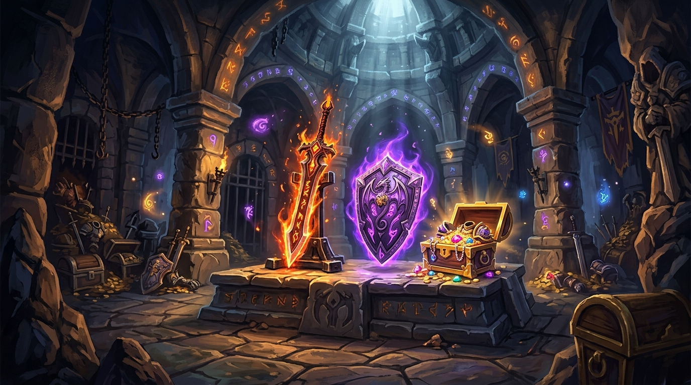

# Item Level Scaling for Turtle WoW (vMaNGOS)



Dynamic dungeon and raid equipment scaling module for **Turtle WoW** custom vMaNGOS (`tortoise-wow` client 1.18.1.7272 / Interface 11200) and **TortoiseBots**.

The module dynamically adapts instanced equipment drops to the current party and encounter hierarchy, permanently publishing persistent synthetic variants into the native `ItemPrototype` store without modifying engine sources or requiring client patches.

---

## 1. Key Features

- **Dynamic Encounter Scaling**: Scales item stats, armor, weapon damage, and required levels upward or downward based on creature levels or highest real player levels.
- **Native Loot Preservation**: Skips scaling automatically when original Blizzard loot already matches target progression.
- **Controlled Variance**: Optional floor/ceiling variance rolls for lucky drop upgrades.
- **Zero Core Modifications**: Fully adheres to **The Unediting Doctrine**; zero edits or patches to `tortoise-wow` or `TortoiseBots`.
- **Pre-Allocated Template Pool**: Generates and manages runtime synthetic item variants safely without memory rehashing or pointer invalidation.
- **Durable InnoDB Persistence**: All generated variants are saved transactionally to the world database and restored seamlessly on server restarts.
- **TortoiseBots Interoperability**: Excludes headless playerbots from determining scaling levels when `ItemScaling.RealPlayersOnly = 1`.
- **Cross-Platform**: Fully compatible with Linux (Ubuntu 22.04 / 24.04 LTS) and Windows.

---

## 2. Installation

### 2.1 Clone or Link the Module

Place the module inside the `modules/` directory of your TortoiseWoW tree:

```bash
cd /path/to/tortoise-wow/modules
git clone https://github.com/Ildourol/mod-twow-item-level-scaling.git mod-twow-item-level-scaling
```

Module structure:

```text
tortoise-wow/
├── modules/
│   └── mod-twow-item-level-scaling/
│       ├── conf/
│       │   └── mod-twow-item-level-scaling.conf.dist
│       ├── data/
│       │   └── sql/world/
│       ├── src/
│       ├── mod-twow-item-level-scaling.cmake
│       ├── mod-twow-item-level-scaling.jpg
│       └── README.md
```

### 2.2 Configuration

Copy the distributed configuration template:

```bash
cp modules/mod-twow-item-level-scaling/conf/mod-twow-item-level-scaling.conf.dist \
   modules/mod-twow-item-level-scaling/conf/mod-twow-item-level-scaling.conf
```

At minimum, ensure the module is enabled in `mod-twow-item-level-scaling.conf`:

```ini
ItemScaling.Enable = 1
```

### 2.3 Configure and Build TortoiseWoW

**Linux / Ubuntu (22.04 & 24.04 LTS):**

```bash
# Install dependencies
sudo apt update && sudo apt install -y build-essential cmake git libace-dev libmysqlclient-dev libssl-dev libbz2-dev zlib1g-dev

cd /path/to/tortoise-wow
mkdir -p build && cd build
cmake .. -DCMAKE_BUILD_TYPE=Release -DMODULE_MOD_TWOW_ITEM_LEVEL_SCALING=static
cmake --build . --target mangosd -j$(nproc)
```

**Windows (Visual Studio 2022):**

```powershell
cd C:\path\to\tortoise-wow
cmake -S . -B build -G "Visual Studio 17 2022" -A x64 -DMODULE_MOD_TWOW_ITEM_LEVEL_SCALING=static
cmake --build build --config Release --target mangosd --parallel
```

### 2.4 Database Migrations

The SQL migrations under `data/sql/world/` are automatically applied by the TortoiseWoW database auto-updater at server startup.

---

## 3. Chat Commands

Gamemaster commands (available in-game and via server console):

- `.itemscaling status` or `.mils status` — Displays operational status, active scaling method, diagnostics, and template cache metrics.
- `.itemscaling preview <itemId> <targetLevel>` — Simulates item scaling for a specific item and target level, outputting projected stats, armor, weapon damage, and item level.
- `.itemscaling reload` — Reloads module configuration without restarting the worldserver.

---

## 4. How Item Scaling Is Calculated

Scaling takes place in two stages: selecting an effective target level for the drop, then calculating the target item level and equipment attributes. These formulas describe the current implementation in `ItemScalingTarget.h`, `ItemScalingBaseline.cpp`, and `ItemScalingFormula.cpp`.

### 4.1 Effective target level

Let:

- `H` = highest eligible player level (real players are prioritized when configured, with bot fallback).
- `C` = observed effective creature level.
- `F` = configured floor offset, after any rolled floor variance.
- `U` = configured ceiling offset, after any rolled ceiling variance.
- `Lmin`, `Lmax` = configured minimum and maximum scaling levels.

For **dynamic** mode, when a creature is available:

```text
T = clamp(C - F, Lmin, min(H + U, Lmax))
```

The implementation then clamps the result to `[Lmin, Lmax]`. In **fixed** mode, or without a creature, `T = clamp(H, Lmin, Lmax)`. The creature level is resolved using the module's effective-creature-level logic, rather than necessarily the unmodified creature template level. Floor/ceiling values can differ by instance category or override.

### 4.2 Target item level (iLvl)

Let `I0` be the item's original item level, `L0` its native reference level (required level if nonzero, otherwise item level clamped to 1–80), and `T` its chosen target effective level.

At startup, the module constructs median item-level curves from eligible existing equipment, grouped by **reference level, item quality, and equipment slot family**. Empty baseline cells use interpolation, extrapolation, or quality-based fallback estimates.

Define `M(level, quality, family)` as that median baseline. For different native and target levels, the formula is:

```text
I1 = clamp(round(I0 × M(T, quality, family)
                       / M(L0, quality, family)), 1, 300)
```

If a baseline ratio cannot be used, the fallback is:

```text
I1 = clamp(round(I0 × T / max(1, L0)), 1, 300)
```

When `T == L0`, the original item level is returned. The calculation substitutes `max(1, RequiredLevel)` for `I0` if the stored item level is zero. The template writer limits the stored synthetic item-level field to 255.

### 4.3 Stat budget and equipment attributes

The stat budget multiplier is the ratio of target item level to the **original stored** item level:

```text
R = I1 / max(1, original ItemLevel)
```

The implementation uses `R = 1` if the item levels are equal or the original item level is zero. The multiplier is linear; quality and equipment family affect the *baseline target item level*, not an additional exponent on `R`.

For each nonzero additive stat (Strength, Stamina, Intellect, etc.):

```text
newStat = round(originalStat × R)
```

When `ItemScaling.PreserveNonZeroStats = 1`, a nonzero original stat that rounds to zero is kept at +1 or -1 according to its original sign. Calculated values are bounded by the destination integer type.

Armor is multiplied by `R` and rounded, with a minimum of 1 for eligible positive armor when the reference level changes. Shield block is multiplied by `R` and rounded. Resistances use additive scaling and are clamped to signed 16-bit bounds.

Weapon damage keeps the original relative minimum-to-maximum spread. The code multiplies average damage by `R`, reconstructs minimum and maximum using the original spread, and rounds the result; positive-damage weapons enforce a minimum damage of 1. If the native and target reference levels match, armor and weapon damage retain their original values.

On-equip effects and supported random-property bonuses have separate eligibility/baking rules and are not guaranteed to scale for every item.

### 4.4 Worked example

Suppose a level-50 character encounters a level-52 creature in dynamic mode, with floor `F = 3`, ceiling `U = 0`, and level bounds 1–60:

```text
T = clamp(52 - 3, 1, min(50 + 0, 60)) = 49
```

Assume the original item has `I0 = 40` at reference level 40, and its quality/slot baseline medians are `M(40) = 42` and `M(49) = 52`. These median values are **illustrative**; actual medians come from the loaded server items.

```text
I1 = round(40 × 52 / 42) = 50
R  = 50 / 40 = 1.25
Original +12 Stamina → round(12 × 1.25) = +15 Stamina
Original 80 Armor  → round(80 × 1.25) = 100 Armor
```

The module can leave eligible original loot untouched when native progression matches the chosen level, and filters items according to configuration before generating variants.

---

## 5. License & Credits

- Community module for the TortoiseWoW custom vMaNGOS server.
- Licensed under the GNU General Public License v2 (GPLv2).
