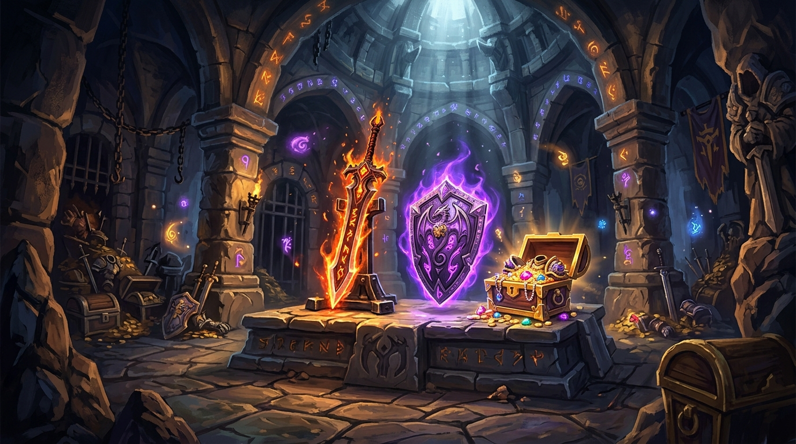

# Item Level Scaling for Turtle WoW (vMaNGOS)



Dynamic dungeon and raid equipment scaling module for **Turtle WoW** custom vMaNGOS (`tortoise-wow` client 1.18.1.7272 / Interface 11200) and **TortoiseBots**.

The module dynamically adapts instanced equipment drops to the current party and encounter hierarchy, permanently publishing persistent synthetic variants into the native `ItemPrototype` store without modifying engine sources or requiring client patches.

---

## 1. Key Features

- **Dynamic Encounter Scaling**: Scales item stats, armor, weapon damage, and required levels upward or downward based on creature levels or highest real player levels.
- **Native Loot Preservation**: Skips scaling automatically when original Blizzard loot already matches target progression.
- **Controlled Variance**: Optional floor/ceiling variance rolls for lucky drop upgrades.
- **Zero Core Modifications**: Fully adheres to **The Unediting Doctrine**; zero edits or patches to `tortoise-wow` or `TortoiseBots`.
- **Pre-Allocated Template Pool**: Generates and manages runtime synthetic item variants safely without memory rehashing or pointer invalidation.
- **Durable InnoDB Persistence**: All generated variants are saved transactionally to the world database and restored seamlessly on server restarts.
- **TortoiseBots Interoperability**: Excludes headless playerbots from determining scaling levels when `ItemScaling.RealPlayersOnly = 1`.
- **Cross-Platform**: Fully compatible with Linux (Ubuntu 22.04 / 24.04 LTS) and Windows.

---

## 2. Installation

These steps assume you have a working [TortoiseWoW](https://github.com/Penqle/tortoise-wow) source checkout, initialized core databases, and the server data files for your realm. Use a core revision compatible with this module. Run all build and SQL commands from the core source root, the directory containing the core's `CMakeLists.txt`.


### 1. Add the module and build on Linux

Use Git, CMake, a C++17 compiler, and the core's build dependencies. On Debian or Ubuntu, a typical starting point is:

```bash
sudo apt update
sudo apt install git cmake build-essential libace-dev default-libmysqlclient-dev libssl-dev zlib1g-dev
```

Use your distribution's `mysql` or `mariadb` command-line client if importing SQL manually. Keep any additional dependency and CMake settings required by your core and other enabled modules.

```bash
cd /path/to/tortoise-wow
git clone https://github.com/Ildourol/mod-twow-item-level-scaling.git modules/mod-twow-item-level-scaling
cmake -S . -B build -DCMAKE_BUILD_TYPE=Release -DCMAKE_INSTALL_PREFIX="$PWD/server-stage" -DMODULE_MOD_TWOW_ITEM_LEVEL_SCALING=static
cmake --build build --parallel
cmake --install build
```

### 2. Add the module and build on Windows

Install Git for Windows, CMake 3.21 or later, and Visual Studio 2022 or its Build Tools with **Desktop development with C++** and a Windows SDK. Open PowerShell with Git and CMake on `PATH`. Use an x64 build and the dependency setup of your working core.

```powershell
Set-Location 'C:\src\tortoise-wow'
git clone https://github.com/Ildourol/mod-twow-item-level-scaling.git modules/mod-twow-item-level-scaling
cmake -S . -B build-vs -G "Visual Studio 17 2022" -A x64 "-DCMAKE_INSTALL_PREFIX=$PWD/server-stage" -DMODULE_MOD_TWOW_ITEM_LEVEL_SCALING=static
cmake --build build-vs --config Release --parallel
cmake --install build-vs --config Release
```

Check each command for errors before continuing. Both builds include `mangosd`. If the configure output reports an unused module switch, verify the source placement before building. The two build sections are platform alternatives. If you already have a module checkout, use it in place of the clone. A full directory copy, a Linux symlink, or a Windows directory junction works as long as `modules/mod-twow-item-level-scaling/src/` is directly below the module directory. The module directory name determines the CMake switch and loader symbol. If reusing a build directory, keep its generator and architecture and preserve the switches for your other modules. Reconfigure after adding the module and verify CMake lists it as static.

The staged world server is normally `server-stage/bin/mangosd` on Linux and `server-stage/mangosd.exe` on Windows. Stop the running world server before deploying the rebuilt executable and any required runtime libraries or module assets. Preserve the live configuration and data files. The paths below assume the standard staged layout. For an existing deployment, use the directory containing the active `mangosd.conf`, including a custom path passed via `-c`.

### 3. Set up the database

Back up the affected databases. The examples use `tw_char` and `tw_world` as database names. Substitute the names from the active `CharacterDatabase.Info` and `WorldDatabase.Info` settings as applicable, plus your database user and any connection options.

Choose 1 import method. For the core auto-updater, verify that `Database.AutoUpdate.Enabled` and `Database.AutoUpdate.SortByName` are enabled, that `Database.AutoUpdate.AllowedModules` includes `mod-twow-item-level-scaling` (or uses `all`), and that the runtime host can access the module checkout at the source path embedded by the build. The updater uses the configured `CharUpdateName` and `WorldUpdateName` under `data/sql/` (normally `character` and `world`). Check the first startup log for applied updates. If importing manually, exclude this module from the updater allowlist to avoid replaying the same files. Preserve other modules that use automatic updates.

Review the maintenance impact before import. The first script converts the core's `item_template` table to InnoDB, which can take time and lock the table. The second removes obsolete staging tables. The last creates the variant registry.

**Manual import on Linux (Bash)**

```bash
mysql -u root -p tw_world < "modules/mod-twow-item-level-scaling/data/sql/world/002_convert_item_template_innodb.sql"
mysql -u root -p tw_world < "modules/mod-twow-item-level-scaling/data/sql/world/mod_item_level_scaling_live.sql"
mysql -u root -p tw_world < "modules/mod-twow-item-level-scaling/data/sql/world/scaled_item_variant.sql"
```

**Manual import on Windows (PowerShell)**

Run `Get-Command mysql.exe` first. If it is unavailable, install the MySQL or MariaDB command-line client and add its `bin` directory to the current PowerShell session. Replace the example path below with your installation path. Use `mariadb.exe` in the import commands if that is the client you installed. Run imports in the order shown and stop if any command reports an error. `cmd.exe` handles input redirection so the SQL file reaches the client directly.

```powershell
# Only needed when mysql.exe is installed but missing from PATH
# $env:Path = 'C:\Program Files\MySQL\MySQL Server 8.0\bin;' + $env:Path
cmd.exe /d /c 'mysql.exe -u root -p tw_world < modules\mod-twow-item-level-scaling\data\sql\world\002_convert_item_template_innodb.sql'
if ($LASTEXITCODE -ne 0) { throw "Module SQL import failed" }
cmd.exe /d /c 'mysql.exe -u root -p tw_world < modules\mod-twow-item-level-scaling\data\sql\world\mod_item_level_scaling_live.sql'
if ($LASTEXITCODE -ne 0) { throw "Module SQL import failed" }
cmd.exe /d /c 'mysql.exe -u root -p tw_world < modules\mod-twow-item-level-scaling\data\sql\world\scaled_item_variant.sql'
if ($LASTEXITCODE -ne 0) { throw "Module SQL import failed" }
```

### 4. Deploy and enable the configuration

Create `mod-twow-item-level-scaling.conf` inside the `modules/` subdirectory beside the active `mangosd.conf`. For a first install using the example staging directory, the following commands copy the shipped template. If an active module config already exists, retain it and merge new settings from the template.

**Linux**

```bash
mkdir -p server-stage/etc/modules
cp -n "modules/mod-twow-item-level-scaling/conf/mod-twow-item-level-scaling.conf.dist" "server-stage/etc/modules/mod-twow-item-level-scaling.conf"
```

**Windows (PowerShell)**

```powershell
New-Item -ItemType Directory -Force 'server-stage/modules' | Out-Null
if (-not (Test-Path 'server-stage/modules/mod-twow-item-level-scaling.conf')) {
    Copy-Item 'modules/mod-twow-item-level-scaling/conf/mod-twow-item-level-scaling.conf.dist' 'server-stage/modules/mod-twow-item-level-scaling.conf'
}
```

Keep the template's section header and confirm `ItemScaling.Enable = 1` in the active file. Start the rebuilt server with your normal launcher and active `mangosd.conf`. Check the startup log for module configuration, database, and dependency errors.

### Verify the installation

Run `.itemscaling status` or `.mils status` with an authorized account. Check the startup log for registry errors before testing scaled items.

## 3. Chat Commands

Gamemaster commands (available in-game and via server console):

- `.itemscaling status` or `.mils status` — Displays operational status, active scaling method, diagnostics, and template cache metrics.
- `.itemscaling preview <itemId> <targetLevel>` — Simulates item scaling for a specific item and target level, outputting projected stats, armor, weapon damage, and item level.
- `.itemscaling reload` — Reloads module configuration without restarting the worldserver.

---

## 4. How Item Scaling Is Calculated

Scaling takes place in two stages: selecting an effective target level for the drop, then calculating the target item level and equipment attributes. These formulas describe the current implementation in `ItemScalingTarget.h`, `ItemScalingBaseline.cpp`, and `ItemScalingFormula.cpp`.

### 4.1 Effective target level

Let:

- `H` = highest eligible player level (real players are prioritized when configured, with bot fallback).
- `C` = observed effective creature level.
- `F` = configured floor offset, after any rolled floor variance.
- `U` = configured ceiling offset, after any rolled ceiling variance.
- `Lmin`, `Lmax` = configured minimum and maximum scaling levels.

For **dynamic** mode, when a creature is available:

```text
T = clamp(C - F, Lmin, min(H + U, Lmax))
```

The implementation then clamps the result to `[Lmin, Lmax]`. In **fixed** mode, or without a creature, `T = clamp(H, Lmin, Lmax)`. The creature level is resolved using the module's effective-creature-level logic, rather than necessarily the unmodified creature template level. Floor/ceiling values can differ by instance category or override.

### 4.2 Target item level (iLvl)

Let `I0` be the item's original item level, `L0` its native reference level (required level if nonzero, otherwise item level clamped to 1–80), and `T` its chosen target effective level.

At startup, the module constructs median item-level curves from eligible existing equipment, grouped by **reference level, item quality, and equipment slot family**. Empty baseline cells use interpolation, extrapolation, or quality-based fallback estimates.

Define `M(level, quality, family)` as that median baseline. For different native and target levels, the formula is:

```text
I1 = clamp(round(I0 × M(T, quality, family)
                       / M(L0, quality, family)), 1, 300)
```

If a baseline ratio cannot be used, the fallback is:

```text
I1 = clamp(round(I0 × T / max(1, L0)), 1, 300)
```

When `T == L0`, the original item level is returned. The calculation substitutes `max(1, RequiredLevel)` for `I0` if the stored item level is zero. The template writer limits the stored synthetic item-level field to 255.

### 4.3 Stat budget and equipment attributes

The stat budget multiplier is the ratio of target item level to the **original stored** item level:

```text
R = I1 / max(1, original ItemLevel)
```

The implementation uses `R = 1` if the item levels are equal or the original item level is zero. The multiplier is linear; quality and equipment family affect the *baseline target item level*, not an additional exponent on `R`.

For each nonzero additive stat (Strength, Stamina, Intellect, etc.):

```text
newStat = round(originalStat × R)
```

When `ItemScaling.PreserveNonZeroStats = 1`, a nonzero original stat that rounds to zero is kept at +1 or -1 according to its original sign. Calculated values are bounded by the destination integer type.

Armor is multiplied by `R` and rounded, with a minimum of 1 for eligible positive armor when the reference level changes. Shield block is multiplied by `R` and rounded. Resistances use additive scaling and are clamped to signed 16-bit bounds.

Weapon damage keeps the original relative minimum-to-maximum spread. The code multiplies average damage by `R`, reconstructs minimum and maximum using the original spread, and rounds the result; positive-damage weapons enforce a minimum damage of 1. If the native and target reference levels match, armor and weapon damage retain their original values.

On-equip effects and supported random-property bonuses have separate eligibility/baking rules and are not guaranteed to scale for every item.

### 4.4 Worked example

Suppose a level-50 character encounters a level-52 creature in dynamic mode, with floor `F = 3`, ceiling `U = 0`, and level bounds 1–60:

```text
T = clamp(52 - 3, 1, min(50 + 0, 60)) = 49
```

Assume the original item has `I0 = 40` at reference level 40, and its quality/slot baseline medians are `M(40) = 42` and `M(49) = 52`. These median values are **illustrative**; actual medians come from the loaded server items.

```text
I1 = round(40 × 52 / 42) = 50
R  = 50 / 40 = 1.25
Original +12 Stamina → round(12 × 1.25) = +15 Stamina
Original 80 Armor  → round(80 × 1.25) = 100 Armor
```

The module can leave eligible original loot untouched when native progression matches the chosen level, and filters items according to configuration before generating variants.

---

## 5. License & Credits

- Community module for the TortoiseWoW custom vMaNGOS server.
- Licensed under the GNU General Public License v2 (GPLv2).
